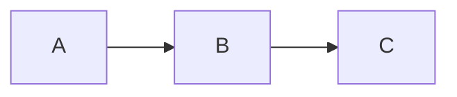

### Diagrams
Use **Mermaid** syntax inside fenced code blocks to render diagrams, graphs, flowcharts, and visual representations. Eg

Read "Y vs X" as Y on the y axis, X on the x axis, eg "Height vs Time".