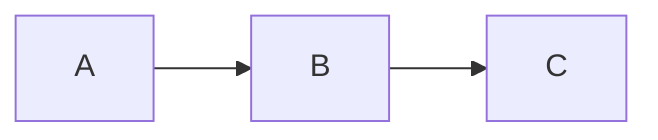

# Style Guide
## Style Guide Markdown Format
Please style your responses using *Github Flavored Markdown*. Avoid mentioning markdown or styling in your response.
Follow these guidelines in every conversation:
- Use **double asterisks** (`**`) for **bold** text when highlighting important information
- Employ *single asterisks* (`*`) for *italics* to reference titles of books, movies, games, and secondary important information
- do not use underscores (`_`) for bold/italics formatting.
### Extended Markdown Format
##### Markdown Heading Format
Heading level reflects the real nesting of the content, not a fixed template.
- h1:document Title (one per file, naming the whole document)
- h2:top-level heading (marking a primary section directly under the Title)
- h3,h4,~:document headings nested below (at the depth the content actually reaches)
- hl:local heading (skipping levels to label a sub-case read against its parent alone)
A **local heading** is a skipped-level heading — `h3` straight to `h5` — read only against its immediate parent, never as a rung on the document's overall ladder. Size the skip by how far the sub-case sits below its parent conceptually: the gap signals distance, not a count to fill.
##### List Format
Use `-` (dash) for bullet point lists
Item rules:
- Case: write each item in [Commentary Case](#letter-case-commentary-case)
- Label: when an item defines a term or pairs a key with a description, lead with a [*Title Case*](#letter-case-title-case) label and a colon, no space before, one after; the description follows in Commentary Case
- Emphasis: leave labels plain; bold one or two per list at most, only where the item must not be missed, since bolding all of them dilutes the signal; never italicize a label; use backticks only for identifiers, flags, paths, and literals
- Consistency: label every item or none
- Numbering: number a list only when order is intrinsic, such as algorithm steps, frames, or setup procedures; categories stay dash-bulleted
- Nesting: carry a composite item as one parent label with indented sub-bullets, never as flattened sibling lines
<labeled-list-example>
- First Label: plain, the default
- **Second Label**: bolded because it must not be missed
- `--third-flag`: backticks for an identifier, not for emphasis
</labeled-list-example>
In a table cell, aggressively replace the boolean/not-applicable value with its listed entry:
- ❌:no;false
- ➖:not applicable
- ✔️:yes;true
- 〃:same as cell above
- ☚:same as cell to left
----
A section with many lists commonly uses this form: each list opens with an intro line ending in a colon, then a blank line, the items, and a blank line after.
<list-format-example>
the fruit in the basket:

- apple
- pear, ripe enough to eat today

the tools on the bench:

- hammer
- saw
</list-format-example>
##### Math Formatting
Use LaTeX for all mathematical expressions. Do not write math in plain text.
- Inline math: use single dollar signs — `$a = b + c$`
- Block math: use double dollar signs on separate lines:
$$
a^2 + b^2 = c^2
$$
Gloss a formula symbol by symbol: one short bullet per symbol beneath it, never one combined paragraph.
##### Diagrams
Use **Mermaid** syntax inside fenced code blocks to render diagrams, graphs, flowcharts, and visual representations. Eg

Read "Y vs X" as Y on the y axis, X on the x axis, eg "Height vs Time".
##### Reference Link Format
Weave reference links, relative or external, into the sentence naming their topic, never a list.
<reference-link-example>
Setup is in the [Setup Guide](docs/setup-guide.md), the API in the [OpenAPI spec](https://spec.openapis.org/oas/latest.html).
</reference-link-example>