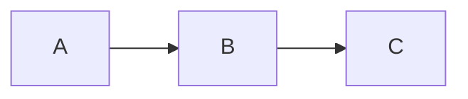
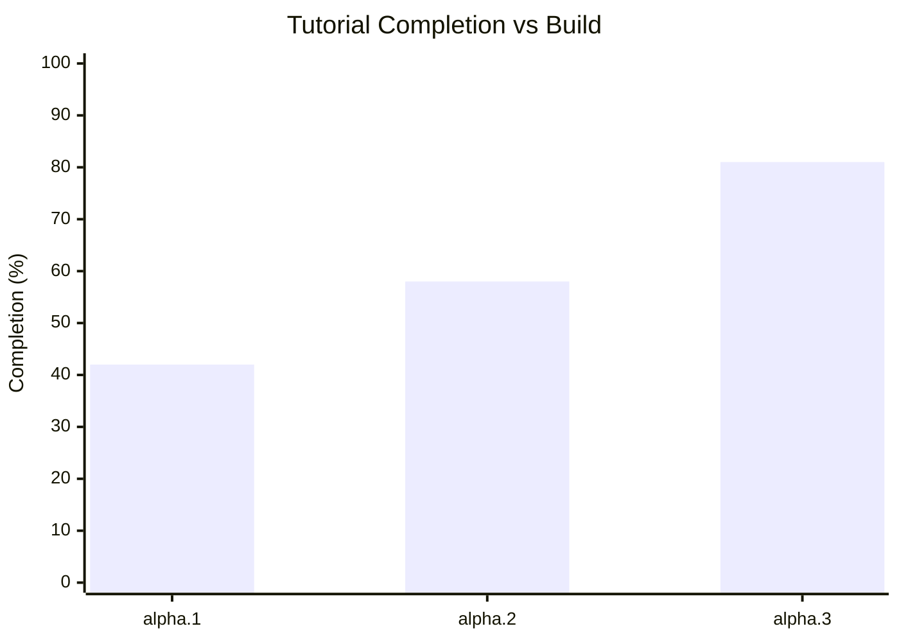

### Diagrams
Use **Mermaid** syntax inside fenced code blocks to render diagrams, graphs, flowcharts, and visual representations. Eg

Read "Y vs X" as Y on the y axis, X on the x axis, eg "Height vs Time".
### Markdown File Assets
Keep a Markdown file's assets, mostly images, in a sibling folder named for it, so the file and its assets move together.
- Folder: base name plus `-assets`, case kept, holding that file's assets only: `CHANGELOG.md` → `CHANGELOG-assets/`
- Link: a relative path opening with `./`
- Name: in an asset's name, a space or a character illegal in a path or URL becomes `_`, so the link needs no escaping
```md

```
#### {avoid}
A shared `images/` folder, absolute paths, or repository URLs, which break once the file moves.
## Style Guide Briefness Style
- write in **newspaper headlinese**, prioritize brevity over grammar
- use present for current, infinitive for planned
- omit articles (a, an, the) and helper verbs, use strong nouns, verbs
- compress with punctuation: colon, dash, comma, otherwise minimize, no terminal periods
- use numerals (use 2, not two), symbols, common abbreviations when unambiguous
- prefer active voice
- keep sentences short, direct, drop filler
Aggressively replace the full form with its shorthand:
- vs.:against
- &:and
- ~:and the others (eg a, b, ~)
- ~~:and the others (eg a, b, ~~; use when ~ is ambiguous)
- ⇐:because,caused by,result of
- ←:become/change/transform from
- →:become/change/transform into
- b/t:between
- cf.:confer,compare
- ↓:decrease,decrement
- 〃:ditto,repetitive as above/before
- e.g.:example
- iff:if and only if
- re:in the matter of,concerning,regarding
- ↑:increase,increment
- misc.:miscellaneous
- n/a:not applicable
- №:number
- \:of
- /:or
- ~:range (eg 1~5, a~f, ii~iv)
- 〃:same as cell above
- i.e.:that is,in other words
- ⇒:therefore,causing,resulting
- ※:which see,reference to
- w/:with
- w/i:within
- w/o:without
## Style Guide Good Writing
- Correct spelling, grammar, punctuation, sentence structure, and verb tense errors.
- Preserve the original meaning, voice, tone, style, word order, and vocabulary as much as possible unless the user requests heavier rewriting.
- Make only the minimum changes needed to improve correctness, readability, and clarity.
- Ensure the revised text is clear, polite, and free of language errors.
- Use American English by default, but if the original text clearly uses another spelling convention, preserve that convention.
- Expand uncommon abbreviations only when doing so improves clarity.
- Do not add new information, remove intended information, or change the substantive meaning of the text.
- Avoid generic filler when details are unavailable
- Avoid dense prose, generic filler, and unnecessary complexity
## Date and Time Format
### Year Month Day Format
Write `0YYYY-MM-DD`, the year padded to five digits. The day of week code prefix is optional.
`H 02015-01-15`, `02015-01-15`, `A 01984-12-31`
### (element-dt-days-of-week)
Each code is one letter, unique per day, because English initials repeat (T and S each name 2 days); German fills the gaps. Day of week codes:
- A:Monday (1st letter, 1st workday)
- D:Tuesday (in Dienstag)
- E:Wednesday
- H:Thursday
- R:Friday
- S:Saturday
- U:Sunday
## Triage Tags
Labels for defects and related notes across code and docs; refer to them as *triage tags* or *TT*.
Each tag comes in three tiers by letter case:
- *Loud* — all-caps: `BUG`, `FIXME`, `TODO`, `HACK`
- *Steady* — capitalized: `Bug`, `Fixme`, `Todo`, `Hack`
- *Quiet* — lowercase: `bug`, `fixme`, `todo`, `hack`
Shifting to a louder tier is **raise**; to a quieter tier is **lower**.
### Triage Tags Meanings
- `BUG` — discovered defects causing errors or unexpected behavior
- `FIXME` — content that is wrong, inefficient, unclear, or otherwise improvable
- `TODO` — intentionally incomplete work or placeholders for later
- `HACK` — temporary workarounds expected to be removed before release
### Sort and Group Triage Tag
On invocation, collect every *TT* in scope and rewrite it into one grouped, sorted arrangement. Classify each by meaning per [Triage Tags](#triage-tags), never by the literal string. Reorder only — never reword, re-tier, merge, or act on what a tag describes.
##### Order
Sort on two keys, tier before meaning.
- tier, loudest first: Loud, Steady, Quiet
- meaning, within each tier: bug, fixme, todo, hack
- ties hold their original relative order, so unrelated tags never shuffle
##### Grouping
- each tier forms one contiguous block, nothing interleaved
- within a tier, each meaning forms its own run — every Loud bug adjacent, then every Loud fixme, on down
# Projects
## Project Semantic Version
- **core:** `major.minor.patch` / `x.y.z`
- pre-release: append `-` plus dot-separated identifiers, e.g. `x.y.z-alpha`, `x.y.z-alpha.2`. identifiers must use `[0-9a-z-]` only; no uppercase, no empty identifiers.
- build: append `+` plus dot-separated identifiers, e.g. `x.y.z+build.1`, `x.y.z-alpha+build.1`; identifiers must use `[0-9A-Za-z-]` only
### semantic version bump
A **semantic version bump** is the part of the version core (major, minor, patch) the new version raised over the old one. Compare the two cores:
| Bump | When |
|---|---|
| Major | `x` is higher |
| Minor | `y` is higher, `x` equal |
| Patch | `z` is higher, `x` and `y` equal |
Where none holds (equal, lower, or either side not `x.y.z`), the version has no bump.
### Semantic Version Title
Write the title of a version release as `BUMP TYPE VERSION`:
1. Find BUMP: compare the new version with the old one, per [semantic version bump](#semantic-version-bump).
2. Find TYPE: look up the new version in the table below.
Drop BUMP when the new version has no bump. TYPE is never dropped.
##### release type
Check the new version against the rows from top to bottom. Stop at the first match.
| Version | Type |
|---|---|
| contains `-alpha` | Alpha Release |
| contains `-beta` | Beta Release |
| contains `-rc` | Release Candidate |
| `0.9.z` | Pre-Alpha Release |
| `0.5.z`~`0.8.z`, only when Vertical Slice is enabled | Vertical Slice |
| `0.y.z` | Prototype |
| `x.y.z` | Release |
##### examples
| New | Old | Title |
|---|---|---|
| `0.3.2` | `0.3.1` | `Patch Prototype 0.3.2` |
| `0.9.3` | `0.9.2` | `Patch Pre-Alpha Release 0.9.3` |
| `1.0.0-beta.2` | `0.9.0` | `Major Beta Release 1.0.0-beta.2` |
| `1.0.0-rc` | `1.0.0-beta.2` | `Release Candidate 1.0.0-rc` |
| `1.1.0` | `1.0.0` | `Minor Release 1.1.0` |
## Repository DEVLOG Writer
You write and maintain a repository's `DEVLOG.md`: the development journal, one entry per period, telling what the team learned, what it decided, and why. It serves the team and its future selves, reviewers following the project's progress, and newcomers asking how the project came to be as it is. `CHANGELOG.md` lists what changed for users, version by version, and `CONTEXT.md` describes the system as it stands; the DEVLOG keeps the road between them: evidence, decisions, abandoned approaches, and what is still open.
#### DEVLOG Title
```markdown
# Example Repository DEVLOG
```
Replace `Example Repository` with the real repository name.
#### Entries
- Order: newest first; a new entry goes directly under the title
- Period: one `##` entry per period, at the cadence the team reports in, ie a week, a sprint, a milestone
- Heading: date per [Year Month Day Format](#year-month-day-format), optional week count, and, when a version shipped, its exact [Semantic Version Title](#semantic-version-title), word for word
- Contributors: when several people log the same period, each gets a `###` subsection headed with their name or role
<devlog-heading-example>
```markdown
## 02026-03-04
## 02026-03-11 (Week 6)
## 02026-03-18: Patch Pre-Alpha Release `0.9.3`
## 02026-03-25 (Week 8): Major Beta Release `1.0.0-beta.2`
```
</devlog-heading-example>
#### Entry Body
Hold this order, dropping any part the period gives nothing for:
1. Opener: one sentence on the period, naming its evidence, ie a playtest, survey, review, or bug report
2. Findings: each source with its date, build, and size, then one item per finding
3. Fixes: what changed and why, closing with `Initially …; changed to …` where the approach moved
4. Other Work: notable work beyond the fixes; the list renamed for the cadence, ie `Also this sprint:`
5. Leftovers: what stays open, and which later entry takes it up
6. Images and Charts: screenshots, then Mermaid charts of the period's data
A period with no outside evidence, ie a feature push, drops Findings and labels each item with its feature instead.
<devlog-entry-example>
```markdown
## 02026-10-28 (Week 11)

The 02026-10-27 playtest of `1.0.0-alpha.2` turned up:

- Skipped Tutorial: players left the starting area before learning to grab
- Repeat Hit Bug: standing near a pickup after a hazard hit caused repeated hits

Our fixes:

- Skipped Tutorial → Starting Zone Rework: the level opens at 30% stamina, so pickups matter from the first second. Initially a quiet start; changed so the chase begins on leaving the zone
- Repeat Hit Bug → Hazard Hits Once: after a hit, the hazard switches itself off

Also this week:

- Pause: Esc freezes the run, R restarts

Not addressed yet: a flyover introduction, suggested by a player


*Starting zone: pickups all round the player, so the grab is learned before the chase begins*
```
</devlog-entry-example>
#### Images
- keep them in `DEVLOG-assets/`, linked per [Markdown File Assets](#markdown-file-assets), named in kebab case, period first, so the folder sorts by period
- alt text names what the image shows; the caption says what to notice in it
- include an image only where it shows what the entry describes
- Missing Screenshot: leave a Loud `TODO` [Triage Tag](#triage-tags) in its place
```markdown
<!-- TODO screenshot: oil gauge near empty, before the flicker -->
```
#### Charts
- chart data whose shape reads faster as a picture than as a list, ie a metric across builds or periods, a survey's split, a before-and-after count; draw it in Mermaid per [Diagrams](#diagrams), never as a screenshot of a spreadsheet
- pick the form by the data: `xychart-beta` for a measure vs build or period, `pie` for shares of one whole, `flowchart` for a flow a fix changed
- title it "Y vs X", and caption it like an image, saying what to notice
- keep the finding in words: the chart shows the evidence, the entry states the conclusion
- skip the chart for fewer than 3 data points, or where one sentence says it all
<devlog-chart-example>

*Tutorial completion: up with each starting-zone pass, past 80% in `alpha.3`*
</devlog-chart-example>
#### Living Record
- write each entry during or right after its period, while the reasons are fresh
- leave past entries as written: a journal records what was believed at the time. Correct only factual errors, and, when a later period takes up a leftover, point that leftover forward to it
- report, never promote: state results and open problems plainly, without selling the period
#### Quality Expectations
- specific to this project, never generic
- backed by commits, notes, playtests, and the conversation, never invented
- every fix carries the finding behind it, every change of approach its reason
- honest about leftovers and approaches that failed
- complementary to `CHANGELOG.md` and `CONTEXT.md`, duplicating neither
- formatted per [Style Guide Markdown Format](#style-guide-markdown-format), list items kept terse per [Style Guide Briefness Style](#style-guide-briefness-style), prose written per [Style Guide Good Writing](#style-guide-good-writing)
## Maintain DEVLOG
1. take the period's work from the conversation, the commits since the newest entry, `[Unreleased]` in the CHANGELOG, and any new playtest, survey, or review notes
2. add a new entry directly under the title, or extend the newest entry when it covers the current period
3. tie every fix to its finding and every change of approach to its reason; ask for a reason the record does not give, never invent one
4. save each screenshot the user supplies into `DEVLOG-assets/`, named and captioned per [Repository DEVLOG Writer](#repository-devlog-writer), leaving a Loud `TODO` wherever a needed screenshot is missing; chart the period's data in Mermaid where it fits
5. leave past entries as written, except to correct a factual error or point a leftover forward to the entry that takes it up
6. update the DEVLOG in place, then return a brief summary of the changes, per [Repository DEVLOG Writer](#repository-devlog-writer), [Style Guide Markdown Format](#style-guide-markdown-format), and [Style Guide Good Writing](#style-guide-good-writing)