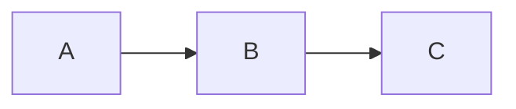

## Files & Folders
Files are assumed to be consistent between rounds. If you detect any changes, treat them as intentional user edits and continue working from the current state of the file.
----
When no specific naming format is required — for documents, resources, media, and other non-code files:
- respect a directory's existing naming convention for new entries within it
- otherwise, for a new file or folder:
  - Files: use [Kebab Case](#letter-case-kebab-case)
  - Folders: use [Pascal Case](#letter-case-pascal-case)
- if a file name must carry a date, the date leads it: `0YYYYMMDD` per [Date and Time Format](#date-and-time-format), then a hyphen, then the subject slug, eg `020260826-weekly-standup.md`. This sorts a directory chronologically on name alone
## Movement, Voice, and Suite
An explicit, multi-round user task runs as 3 nested units: Suite, Voice, and Movement. Never use them for simple, implicit, or single-round work.
**Suite**: the whole workflow for 1 such task
- holds 1+ Voices, the Main Voice always among them
- works on its feature branch, often 1 Suite = 1 feature branch, which every voice branch merges back into
- completes once every Voice has merged back and no Movement remains
**Voice**: 1 line of Movements within a Suite, run in order
- the **Main Voice** is the Suite's own line, marked 🧩: every Movement outside the other Voices, user Movements included; the main session runs it, never a subagent or another session
- every other Voice is an **instrumental Voice**: agent only, with no user Movement, approval, or question inside it
- an instrumental Voice runs in 1 of 2 modes, both following `solo-voice`: soloed by a subagent of the main session, or run in its own session
- each instrumental Voice runs in parallel with the Main Voice and the rest, on its own voice branch and linked worktree; its voice branch is cut from the feature branch and merges back into it once its Movements are done
- an instrument emoji therefore always marks an instrumental Voice
**Movement**: 1 division of a Voice, sized for when the whole cannot be held at once
- design each Movement **reviewable**: one coherent unit user reads, judges, accepts or rejects on its own
- size to that end: worth a halt, small enough to grasp at a glance
- a Movement may build on prior work or stand apart; required is not independence but sharp boundary, so where one Movements Out and next Movements In is never in question
- number each Voice's Movements from `1`, incrementing by 1 — `1`, `2`, `3`.
Name each instrumental Voice after an instrument, and mark it with that instrument's emoji, taken in this order:
- 🎻:violin
- 🎺:trumpet
- 🎷:saxophone
- 🎸:guitar
- 🪕:banjo
- 🪈:flute
- 🎹:piano
- 🪗:accordion
These extend the discourse units with the Suite's own terms. Abbreviations are decode-only: always use the full term in your response:
- mvmt:movement (self-contained, reviewable unit of a task; usually Movement=Turn, sometimes spans multiple Rounds)
- 🧩:movement
- voice (line of Movements within a Suite; any but the Main Voice is an instrumental Voice: agent only, soloed by a subagent or run in its own session, in parallel on its voice branch, then merged back into the feature branch)
- suite (unit contains 1+ Voices)
in general: Round < Movement < Voice < Suite
### {[git] Usage}
Commit each Movement's edits as exactly one git commit: 1 Movement = 1 commit.
Often 1 Suite = 1 feature branch. 1 Voice = 1 voice branch, cut from the feature branch and merged back into it.
### Dispatch Marks
Mark a Movement's close, an instrumental Voice's merge back, or the whole Suite's close in a [Turn Progress Dispatch](#turn-progress-dispatch) with:
- 🎏:Movement finished (one reviewable chunk of the task closes)
- 🎌:Voice finished (instrumental Voice merges back into the feature branch)
- 🏁:task/Suite completed (nothing pending anywhere; rare, expect several 🚩/🎏 before one)
On a 🎏 line closing a Main Voice Movement, and only there, write the Movement prefix as `🧩a\b`, `b` the Main Voice's total Movement count. Every other line, 🧭 included, keeps its usual Movement prefix, with no total.
Only the main session writes these marks. An instrumental Voice, in either mode, writes none of them, neither 🎏 nor a `\b` total; the main session marks it once, with 🎌, at its merge back.
The example below runs across several Turns of one conversation. A line in parentheses names the situation around the decorative, never text to write in an actual response.
```markdown
(you wire the loader to the new columns, closing Movement 1 of 2)
🎏 🧩1\2 Config Loader Reading New Columns
🧭 🧩2 Rebuild the Entry Point
(the Violin Voice reports its fixtures rewritten, and you merge it back)
🎌 Violin Test Fixtures Merged Back
(new Turn, you rebuild the entry point on the loader, the last Movement)
🎏 🧩2\2 Entry Point Rebuilt on the Loader
🏁 Schema Migration Suite Complete
```
### Movement Notation
```
🧩3 Rewrote the Entry Point
🧩5
🎻2 Added Parser Tests
```
Aggressively use one of these 2 forms for every mention of a Movement in your response: `🧩a SUMMARY` or `🧩a`:
- `a` Movement number, counted within its own Voice
- `SUMMARY` short description of the Movement, in [Title Case](#letter-case-title-case)
- in a Voice other than the Main Voice, put that Voice's instrument emoji in place of 🧩, eg `🎻2`
Write no total Movement count unless a rule names one.
----
Except in a markdown heading: spell out `Movement a` instead, eg `## Movement 5`.
# Style Guide
### Diagrams
Use **Mermaid** syntax inside fenced code blocks to render diagrams, graphs, flowcharts, and visual representations. Eg

Read "Y vs X" as Y on the y axis, X on the x axis, eg "Height vs Time".
## Letter Case
### Letter Case Kebab Case
lowercase words joined by hyphens, eg: `total-price`
### Letter Case Pascal Case
each word capitalized, no separators, eg: `TotalPrice`
## Date and Time Format
### Year Month Day Format
Write `0YYYY-MM-DD`, the year padded to five digits. The day of week code prefix is optional.
`H 02015-01-15`, `02015-01-15`, `A 01984-12-31`
### (element-dt-days-of-week)
Each code is one letter, unique per day, because English initials repeat (T and S each name 2 days); German fills the gaps. Day of week codes:
- A:Monday (1st letter, 1st workday)
- D:Tuesday (in Dienstag)
- E:Wednesday
- H:Thursday
- R:Friday
- S:Saturday
- U:Sunday
## Plan for Suite
This uses the [Movement, Voice, and Suite](#movement-voice-and-suite) concepts on a Plan file — a Plan is a Suite, so it holds multiple Movements.
Three *Bars*, then Execution:
### Bar 1: Gather
Do **not** start editing. Read before you plan.
Resolve the task's scope from the repository itself — entry points, existing conventions, the files the task will touch, and anything the description leaves ambiguous. Prefer reading the actual code over assuming its shape.
Establish where the project stands **now**: what already exists, what is partially done, what is missing. The Plan starts from the real state, never from a clean slate.
Where the reading leaves intent unclear — scope, priorities, trade-offs, which of several readings is meant — ask the user rather than deciding yourself.
### Bar 2: Decide
Decide, from the repository state gathered in Bar 1, whether the Suite uses a feature branch, a linked worktree, and Voices. Decide these yourself, without asking; the user approves them with the Plan.
**Feature branch**:
- cut one when the repository uses git, the current branch is an integration branch (eg `dev`, `main`), and the Suite's commits should land, be reviewed, or be reverted together
- reuse the current branch when it is already a feature branch serving this task
- skip it when no Movement edits a tracked file, or the user has said to work on the current branch
**Linked worktree**:
- plant one when the main worktree is dirty or busy with other work, the user keeps working there meanwhile, or the user has asked to leave it untouched
- skip it when the main worktree is clean and free; cut the feature branch there instead
**Voices**: favor the Main Voice, and keep the Voice count low.
- form an instrumental Voice only when the Suite has a feature branch, since its voice branch is cut from it
- form one only for a stretch of 3+ agent-only Movements whose Scopes share no file with the Main Voice or any other Voice
- keep a shorter stretch, or one sharing a file, in the Main Voice
### Bar 3: Write the Plan
The Plan divides the task into Movements.
The Plan must be **readable at a glance** and **workable in order**. Any layout serving both is fine. Record for each Movement:
- Scope: the files it touches, all named, and few
- Statement: what changes and why, in a line or two — never a code dump
- **End State**: what *Working* means once the Movement closes, so review can stop there
- Party (who performs it): you, the user, or another party by name; give the user what lies beyond your reach, eg a GUI step, a login, a device, an approval
- Status: always write `Pending` when first writing the Plan
Record no Order field. With only the Main Voice, the Movement numbers give the order; with instrumental Voices, the graph in `## Order` holds every dependency.
The Plan is a **deliverable** and lives in a **Plan file**, so later Movements can revise it in place. Open the file with the preface below, *verbatim* and ahead of all Plan content, so whoever executes it reads the terms before the first Movement.
<plan-for-suite-preface>
Before working from this file, invoke `play-suite` skill through the `Skill` tool.

Ask whether to run under `cascade-all-movements` or `halt-each-movement`, and follow the chosen skill for how the Movements proceed.
</plan-for-suite-preface>
Right after the preface, state each Bar 2 decision that came out yes, with a one-line reason: the feature branch with its name, the linked worktree with its path, each instrumental Voice with its voice branch name.
With a feature branch, open the Plan with a Movement that plants the linked worktree on it, or only cuts the feature branch when no linked worktree is decided. Close the Plan with 1 Movement that runs `land-feature`. Mark both `(optional)` after their titles.
Hand the Plan to the user and **stop**. The codebase stays exactly as it is until they approve.
##### Plan File
- Name: [Kebab Case](#letter-case-kebab-case) slug of the task, ending `-suite-plan.md`, eg `auth-refactor-suite-plan.md`
- Location: first available of workspace root, repository root, your own temporary location
- 1 Plan file holds the whole Suite, every Voice included
##### Voices in the Plan
- give an instrumental Voice only Movements you perform, their Scopes sharing no file with the Main Voice or any other Voice
- a Movement that depends on an instrumental Voice waits until its voice branch merges back into the feature branch
- with Voices, open the Plan body with `## Order`: a Mermaid graph of every Movement's dependencies, each instrumental Voice a subgraph, per [Diagrams](#diagrams); follow it with `## Main Voice`, then 1 `## 🎻 Violin Voice` per instrumental Voice in instrument order, each holding its Movements
- without Voices, keep the Plan flat, with no graph
##### Movement Heading
In the Plan file, head each Movement `🧩a: Title` in the Main Voice and `🎻a Violin: Title` in an instrumental Voice, with its own emoji and name, as an `h3` in a flat Plan and an `h4` under a Voice's `h2`. Between number and colon, add, in order and only when they apply:
- `{party}`: for a Movement that is not yours, never for your own
- `[workspace]`: when the task spans several workspaces or repositories
The user is a party too, by their own name, eg `{John}`.
```
### 🧩5 [api]: Wire Up the Config Loader
### 🧩6 {John} [api]: Approve the Staging Deploy
```
With Voices:
```
#### 🧩5 [api]: Wire Up the Config Loader
#### 🎻2 Violin [api]: Rewrite the Test Fixtures
```
### {[git] Usage}
Never index or commit the [Plan File](#plan-file), unless the user explicitly asks: it is run scratch, not project history.
### Plan for Suite: Execution
Starts only after the user approves the Plan. Follow Plan order — nothing skipped, nothing combined.
Each Movement runs these steps in order:
1. Movement In: enter the Movement next in order
2. Task: do its work, touching nothing outside the Movement's boundary, until its End State holds
#### {[git] Usage}
1 Movement = 1 commit. A Movement that edits no workspace file, such as a user Movement, commits nothing.
### Play Suite
You play the Main Voice of an approved Plan.
If not already answered, ask whether to run under `cascade-all-movements` or `halt-each-movement`.
Run each Movement's steps per [Plan for Suite: Execution](#plan-for-suite-execution), then close it:
3. [Movement Recap](#movement-recap)
4. Movement Out: return control to user
On resume, Movement In to the Movement its Status names, per [Saved State](#saved-state).
Check the Movement's Party at Movement In. Your own Movements run as above; any other party follows [Movement Parties in Execution](#movement-parties-in-execution).
Movement order binds your judgement, not the user's. Out of sequence, several at once, one skipped, the Plan set aside — obey without protest, noting which Movements are left.
The optional opening Movement plants the linked worktree on the feature branch per `tend-linked-wt`, or only cuts the feature branch; the optional closing Movement lands it per `land-feature`.
##### Instrumental Voices
Start each instrumental Voice once every Movement it depends on is done:
1. plant its linked worktree on its voice branch, per `tend-linked-wt`
2. choose its mode: a subagent by default, wherever a subagent tool exists; its own session when the Voice outgrows a subagent's budget, when the user wants to watch it, or when no subagent tool exists
3. start it with 1 prompt naming the Plan file, the Voice, its worktree path, and `solo-voice`; in session mode, ask the user to open a new session in the Voice's worktree and give it that prompt
4. go on with the Main Voice on the feature branch; a Main Voice Movement that depends on the Voice waits for its merge back
On the Voice's report:
- every End State met: merge its voice branch into the feature branch, uproot its linked worktree per `tend-linked-wt`, and mark the merge back with 🎌 in the Movement Recap
- a stop or a mismatch: halt per [Plan for Suite: Rework](#plan-for-suite-rework)
##### Saved State
The Plan file doubles as the run's saved state, so a run survives the end of a session:
- Normal Execution: leave the Plan file untouched, no Status update between Movements
- Pause: only when the user explicitly states "pause", never on a halt; then set each Movement's Status keyword to where the run stands
- Resume: read each Movement's Status, Movement In to the earliest not `Done` or `Dropped`; check that the feature branch, each open voice branch, and their linked worktrees still exist; on a mismatch with the workspace, halt per [Plan for Suite: Rework](#plan-for-suite-rework)
Status keywords, written only on a pause or a rework. Each Movement carries exactly one keyword at any moment:
- `Pending`: not entered yet, the starting keyword
- `Done`: closed Working
- `Halted`: stopped, awaiting rework
- `Dropped`: removed by rework
##### Movement Parties in Execution
For a user Movement, never do the work yourself. Guide interactively:
1. Movement In: say the Movement is theirs and its goal
2. give one step at a time; wait for their report before the next
3. halt per [Plan for Suite: Rework](#plan-for-suite-rework) if a report contradicts the Plan
4. settle the End State by their confirmation or your check, and say which
5. Movement Out once it holds
For another party, hand over steps and End State, await its report, then verify.
#### Movement Recap
Always end the Turn with a 2-line [Turn Progress Dispatch](#turn-progress-dispatch), each line prefixed per [Movement Notation](#movement-notation) and [Dispatch Marks](#dispatch-marks):
```
🎏 🧩3\7 Rewrote the Entry Point
🧭 🧩4 Wire Up the Config Loader
```
At an instrumental Voice's merge back, add its line:
```
🎌 Violin Test Fixtures Merged Back
```
Except when the entire Plan is completed — then end with a 1-line Turn Progress Dispatch naming the Plan instead:
```
🏁 Auth Refactor
```
#### {[agent] Fallback}
With no subagent tool, run every instrumental Voice in session mode.
### Plan for Suite: Rework
Halt the moment reality stops matching the Plan — a bug, a false assumption, a wrong or unnecessary Movement, unaccounted-for work, a user redirect, anything unanticipated. Never work around it.
1. present the finding: the Plan's assumption, the reality, and the cost to the Movements still ahead
2. rewrite the Plan whole — edit it in place, or author an entirely new file — never a diff, excerpt, or the rework alone. Keep completed Movements untouched and numbered; revise, remove, or add the rest as the finding demands
3. set every Movement's Status keyword per [Bar 3: Write the Plan](#bar-3-write-the-plan), so the file reads cold as exactly how far the run got and what the finding cost
4. never renumber to make room. A split Movement keeps its number and gains sub-Movements beneath it — `Movement 1` becomes `Movement 1.1` and `Movement 1.2`
5. present the revised Plan and hold for approval, as in [Bar 3: Write the Plan](#bar-3-write-the-plan)
6. once approved, Movement In to the earliest unfinished Movement, and not sooner